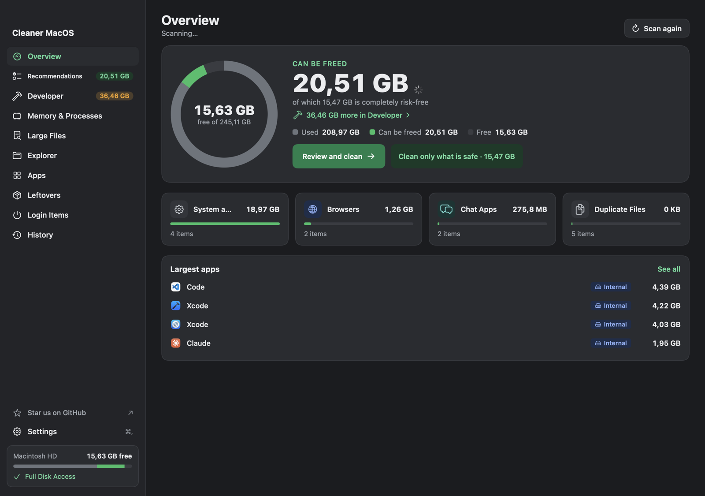
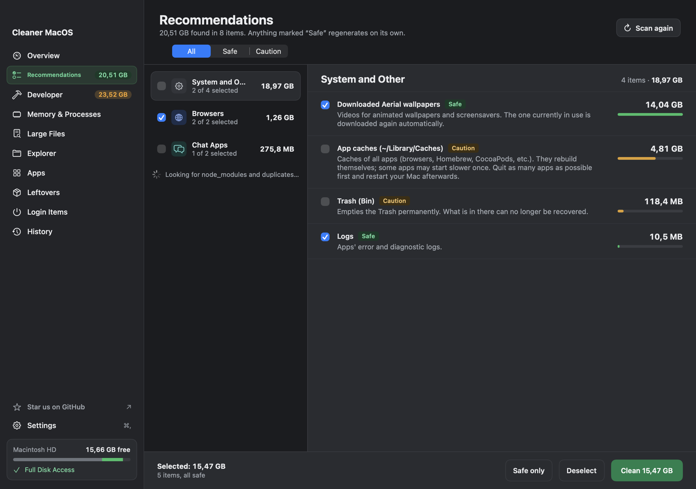

<h1 align="center">Cleaner MacOS</h1>

<p align="center">
  <b>Free up gigabytes on your Mac in a minute. Safely.</b><br>
  A free, open-source and native cleaner for macOS that shows what is taking up space, explains every item and never deletes anything without asking.
</p>

<p align="center">
  <a href="https://github.com/23botnari/cleaner/releases/latest/download/CleanerMacOS.dmg"><b>Download for macOS</b></a>
  &nbsp;·&nbsp;
  <a href="#install">Install with Homebrew</a>
  &nbsp;·&nbsp;
  <a href="#features">Features</a>
</p>

<p align="center"><sub>macOS 15 Sequoia or newer · Apple Silicon · English and Romanian</sub></p>

<p align="center">
  
</p>

<table>
  <tr>
    <td width="33%" valign="top">
      <h3>Safe by default</h3>
      Every item has a risk level and a plain explanation. Only what regenerates on its own is pre-selected, and nothing outside your home folder is ever touched.
    </td>
    <td width="33%" valign="top">
      <h3>Built for developers</h3>
      Finds the gigabytes that pile up from npm, Xcode, simulators, Docker, Gradle, Cargo, pip and old <code>node_modules</code>, project by project.
    </td>
    <td width="33%" valign="top">
      <h3>Free and private</h3>
      No account, no subscription, no tracking. Everything runs on your Mac; the only network call is a daily update check on GitHub.
    </td>
  </tr>
</table>

## Features

<table>
  <tr>
    <td width="55%"></td>
    <td width="45%" valign="middle">
      <h3>Clean what you don't need</h3>
      App caches, logs, browser caches, old downloads, duplicates, Aerial wallpapers and more, grouped by category. Each item says what it is, how big it is and whether it comes back on its own.<br><br>
      One click selects everything marked <b>Safe</b>.
    </td>
  </tr>
  <tr>
    <td width="45%" valign="middle">
      <h3>A whole section for developers</h3>
      Package caches (npm, pnpm, Yarn, Bun, Cargo, Go, Maven, Gradle, pip, Composer, NuGet, pub), Xcode DerivedData, simulators and runtimes, Android, Docker, Homebrew, local AI models and old tool versions from nvm, pyenv, rustup, SDKMAN and more.<br><br>
      Switch to the <b>Projects</b> view to see build folders per project and clear everything you haven't touched in 90 days. Hide the ecosystems you don't use.
    </td>
    <td width="55%"></td>
  </tr>
  <tr>
    <td width="55%"></td>
    <td width="45%" valign="middle">
      <h3>See what is slowing your Mac down</h3>
      RAM, CPU and swap with real memory pressure, your apps ranked by memory or CPU, and tips for the usual suspects: browsers with dozens of processes, Docker's virtual machine, leaking system services.<br><br>
      Quit apps you haven't used in a while with one click, and get a notification when RAM, CPU or disk space runs low.
    </td>
  </tr>
</table>

### And more

| | |
| --- | --- |
| **Large Files and Explorer** | Find big or stale files, reveal them in Finder or move them to the Trash. |
| **Apps** | Size of every app and its data, clear an app's cache, uninstall with all leftovers. |
| **Leftovers** | Files and services left behind by apps you already deleted. |
| **Login Items** | Turn LaunchAgents and LaunchDaemons on or off. |
| **History** | What was cleaned, when, and how much space it freed. |
| **Menu bar** | Free disk space and RAM at a glance, with periodic rescans. |
| **External drives** | Apps and files on external disks are shown and never removed by accident. |
| **Updates** | New versions install in place, only if signed by the same developer. |

## Safety

- Nothing is deleted without your confirmation.
- Only paths inside your home folder are touched. System and personal folders are protected.
- Running apps are never closed unless you choose to close them. Their items are skipped otherwise.
- Downloads, duplicates and leftovers go to the Trash, so you can still restore them.

## Install

**Download:** get [CleanerMacOS.dmg](https://github.com/23botnari/cleaner/releases/latest/download/CleanerMacOS.dmg) and drag **Cleaner MacOS** to Applications. All versions are on the [Releases](../../releases) page.

**Homebrew:**

```bash
brew tap 23botnari/cleaner
brew trust 23botnari/cleaner   # Homebrew 7+ only
brew install --cask cleaner-macos
```

Then:

1. On first launch, right-click the app and choose **Open**, because it is not notarized yet.
2. Grant **Full Disk Access** in *System Settings → Privacy & Security* so that sizes are accurate.

## Build from source

Requires Xcode or the Command Line Tools with Swift 6. No third-party dependencies.

```bash
./build.sh            # build/Cleaner MacOS.app
./build.sh --install  # install to ~/Applications
./build.sh --dmg      # build/CleanerMacOS.dmg
./build.sh --release  # DMG signed with Developer ID and notarized when NOTARY_PROFILE is set
```

## Contributing

Found a bug or have an idea? Open an [issue](../../issues). If Cleaner MacOS freed up some space for you, a ⭐ on GitHub helps other people find it.

## License

[MIT](LICENSE)
