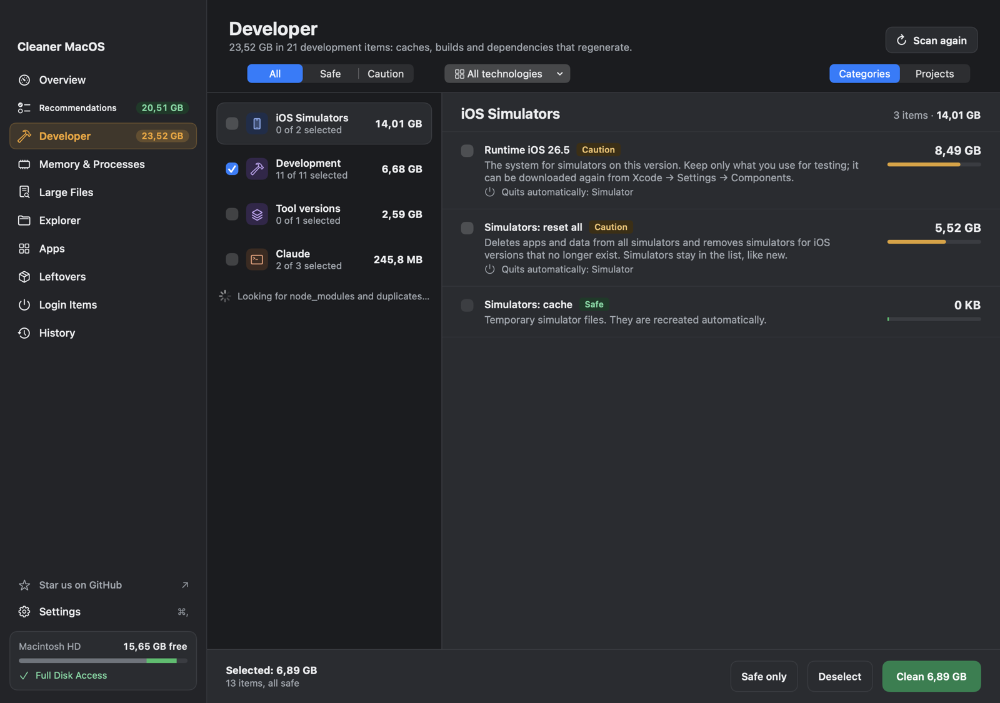
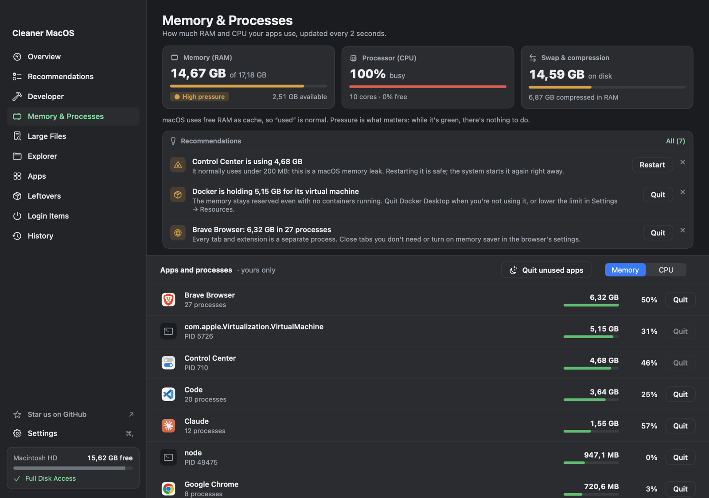

# Cleaner MacOS

A native macOS app that shows what is taking up disk space and cleans it safely. Everything runs locally.


Requires **macOS 15 (Sequoia)** or newer. UI in English and Romanian.

## Features

- **Overview**: free space, how much can be freed, and a breakdown by category.
- **Recommendations**: app caches, logs, browser caches, downloads, duplicates and more. Each item has a risk level: Safe, Care or Suspect. Click anywhere on a row to select it.
- **Developer**: a separate section for package caches (npm, pnpm, Yarn, Bun, Cargo, Go, Maven, Gradle, pip, Composer, NuGet, pub…), Xcode, simulators, Android, Docker, Homebrew, local AI models and old tool versions (nvm, fnm, Volta, pyenv, rbenv, rustup, SDKMAN, Android NDK). Filter by technology and hide the ones you don't use. A **Projects** view groups build folders such as `node_modules`, `.next`, `.expo`, `dist`, `target`, `Pods`, `vendor` or `.venv` per project and can clean everything inactive for 90+ days.
- **Memory & Processes**: RAM, CPU and swap with memory pressure, your apps grouped by memory or CPU use, quit or force-quit, close apps you haven't used in a while, and recommendations for known memory hogs (browsers, Docker, leaking system processes).
- **Large Files / Explorer**: find big or stale files, reveal them in Finder or move them to the Trash.
- **Apps**: size of each app and its data, clear an app's cache, uninstall with leftovers. Apps on external drives are never removed.
- **Leftovers**: files and services left behind by uninstalled apps.
- **Login Items**: enable or disable LaunchAgents and LaunchDaemons.
- **History**: what was cleaned, when, and how much space it freed.
- **Menu bar**: free disk space and RAM at a glance, periodic rescans, and notifications when disk space drops below a threshold (4 GB by default) or when the Mac is under load (under 5% RAM or 10% CPU free).
- **Updates**: checks GitHub Releases once a day and installs a new version in place, after verifying it is signed by the same identity as the installed app.

On first launch the app asks whether you are a developer. If not, the Developer section is hidden and developer folders are not scanned; you can change this in Settings.

| Recommendations | Developer |
| --- | --- |
|  |  |



## Safety

- Nothing is deleted without your confirmation.
- Only paths inside your home folder are touched. System and personal folders are protected.
- Running apps are never closed unless you choose to close them. Their items are skipped otherwise.
- Downloads, duplicates and leftovers go to the Trash.

## Install

1. Download the DMG from [Releases](../../releases/latest) and drag **Cleaner MacOS** to Applications.
2. On first launch, right-click the app and choose **Open**, because it is not notarized.
3. Grant **Full Disk Access** in *System Settings → Privacy & Security* so that sizes are accurate.

## Build from source

Requires Xcode or the Command Line Tools with Swift 6.

```bash
./build.sh            # build/Cleaner MacOS.app
./build.sh --install  # install to ~/Applications
./build.sh --dmg      # build/CleanerMacOS.dmg
./build.sh --release  # DMG signed with Developer ID and notarized when NOTARY_PROFILE is set
```

## Contributing

Bug reports and ideas are welcome in [Issues](../../issues). If the app saved you some space, consider giving it a ⭐ on GitHub.

## License

[MIT](LICENSE)
