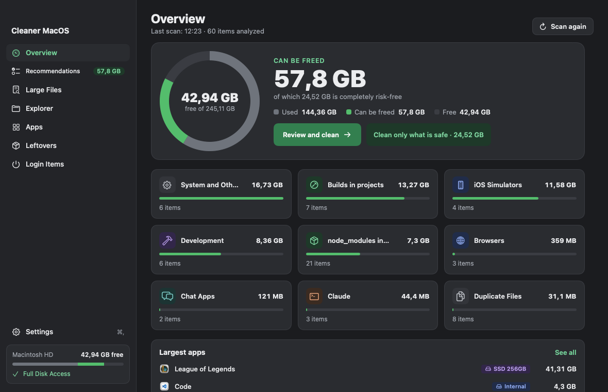

# Cleaner MacOS

A native macOS app that shows what is taking up disk space and cleans it safely. Everything runs locally.



Requires **macOS 15 (Sequoia)** or newer. UI in English and Romanian.

## Features

- **Overview**: free space, how much can be freed, and a breakdown by category.
- **Recommendations**: caches, logs, Xcode, simulators, Docker, Homebrew, node_modules, browser caches, duplicates and more. Each item has a risk level: Safe, Care or Suspect.
- **Large Files / Explorer**: find big or stale files, reveal them in Finder or move them to the Trash.
- **Apps**: size of each app and its data, clear an app's cache, uninstall with leftovers. Apps on external drives are never removed.
- **Leftovers**: files and services left behind by uninstalled apps.
- **Login Items**: enable or disable LaunchAgents and LaunchDaemons.
- **Menu bar**: free space at a glance, a low-space notification and periodic rescans.

## Safety

- Nothing is deleted without your confirmation.
- Only paths inside your home folder are touched. System and personal folders are protected.
- Running apps are never closed unless you choose to close them. Their items are skipped otherwise.
- Downloads, duplicates and leftovers go to the Trash.

## Install

1. Download the DMG from [Releases](../../releases/latest) and drag **Cleaner MacOS** to Applications.
2. On first launch, right-click the app and choose **Open**, because it is not notarized.
3. Grant **Full Disk Access** in *System Settings → Privacy & Security* so that sizes are accurate.

## Build from source

Requires Xcode or the Command Line Tools with Swift 6.

```bash
./build.sh            # build/Cleaner MacOS.app
./build.sh --install  # install to ~/Applications
./build.sh --dmg      # build/CleanerMacOS.dmg
```
